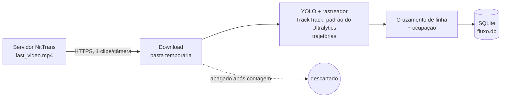
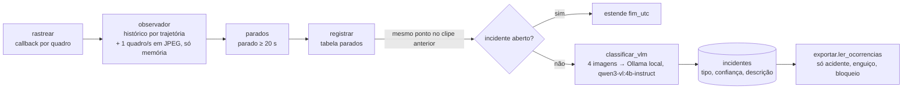
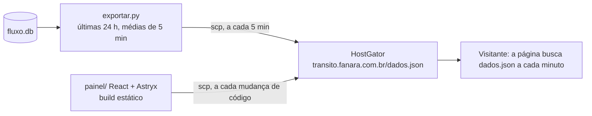

# ARCHITECTURE — Fluxo Niterói

## Arquitetura atual

Um único script Python (`coletor.py`) que roda localmente em laço. Sem servidor, sem interface, sem autenticação.

### Componentes (todos em `coletor.py`)

| Função | Responsabilidade |
|---|---|
| `coletar` | Lê o `Last-Modified`, pula clipe repetido sem baixar o corpo, baixa, chama as demais |
| `rastrear` | Detector + rastreador (Ultralytics); devolve trajetórias, ocupação média e duração |
| `cruzou` / `contar` | Geometria pura: quem cruzou a linha, em que sentido, uma vez por trajetória |
| `linha_do_clipe` / `enquadramento` / `descritor` | Câmera que alterna entre enquadramentos (a 000026): reconhece o enquadramento do clipe por uma miniatura 32x18 com bordas, comparada às de `enquadramentos.json`, e devolve a linha dele; câmera de um enquadramento só usa `linha` |
| `abrir_banco` / `ja_processado` / `gravar` | Persistência. Conexões com espera de 30 s pelo banco; nenhuma transação fica aberta durante uma chamada lenta (o modelo de visão): `registrar` dá `commit` antes de cada uma |
| `main` | Laço, argumentos, tolerância a falha por câmera |

### Incidentes (`incidentes.py`, desde 18/11/2026)

| Função | Responsabilidade |
|---|---|
| `observador` | Callback passado a `coletor.rastrear(ao_quadro=...)`: guarda `(quadro, x, y, largura, altura)` por trajetória e 1 quadro em 10 em JPEG. Não muda `rastrear` nem o formato das trajetórias usado pela contagem e pela validação |
| `parados` | Função pura: trecho parado mais longo de cada trajetória (âncora gulosa, tolerância relativa à altura da caixa, que compensa a perspectiva), posição de parada e número de vizinhos parados |
| `imagens` | Escolhe 3 quadros (início, meio, fim do trecho), desenha a caixa vermelha no veículo e acrescenta uma ampliação (3×) da vizinhança dele no quadro do meio: o veículo longe da câmera tem ~35 px e sem a ampliação o modelo pequeno confundiu posto de combustível com pista |
| `classificar_vlm` | `POST http://localhost:11434/api/chat` (Ollama) com as 3 imagens, `format` = esquema JSON (`tipo`, `confianca`, `descricao`), `temperature` 0 e `think` desligado. Resposta fora do esquema vira `indeterminado` |
| `registrar` | Grava os parados, estende incidente aberto no mesmo ponto (uma vez por clipe) ou abre um novo se havia parado no clipe anterior. Qualquer erro da API vira incidente `indeterminado` com o erro na descrição: a contagem nunca é perdida |
| `criar_tabelas` | `parados` e `incidentes` (`CREATE IF NOT EXISTS`, chamado também pelo exportador) |

O coletor chama `parados` e `registrar` depois de gravar a contagem do clipe, então falha na parte de incidentes não afeta o número já gravado.

### Validação (`validar.py`)

| Função | Responsabilidade |
|---|---|
| `amostrar` | Guarda o clipe original e acrescenta linha em `validacao/manual.csv` |
| `contar_manual` / `sessao` / `_tela` | Contador por teclado (janela do OpenCV): toca o clipe com a linha, uma tecla por veículo (tipo × sentido), pausa, volta 3 s, meia velocidade, desfaz. `sessao` recebe a leitura de tecla e a exibição por parâmetro, por isso é testada sem janela |
| `eventos_auto` | Roda o contador automático e devolve cada cruzamento com o quadro em que ocorreu; confere que o total é igual ao de `coletor.contar`; opcionalmente vídeo de diagnóstico |
| `parear` | Função pura: liga cada veículo contado à mão ao cruzamento automático mais próximo no tempo, no mesmo sentido, e classifica em acerto, classe trocada, perdido ou a mais |
| `erros` | Função pura: erro total (com sinal), erro médio absoluto por clipe e número de perdidos, a mais e trocados, por câmera/condição/sentido/tipo (e `todos`) |
| `comparar` / `_rodar` | Roda uma configuração do detector, ou as três de `CONFIGS` com `--todas`, sobre os clipes contados; grava `resultado_*.csv` e `divergencias_*.csv` por configuração e imprime uma tabela única |
| `referencia` | Conta todos os clipes guardados com um detector mais forte (padrão `yolo11x` a 1280 px) e grava o resultado no formato da contagem manual. `comparar --contra referencia` usa esses arquivos no lugar de `manual.csv`. Mede quanto a contagem muda com mais modelo e resolução, não o erro real |
| `limpar` | Apaga os vídeos dos clipes já contados |

Arquivos em `validacao/` (CSV com `;`, abrem no Excel):

- `manual.csv`: um clipe por linha, com `manual_<tipo>_<sentido>` (8 colunas). Clipe contado = as 8 preenchidas.
- `eventos.csv`: um veículo contado à mão por linha (`arquivo`, `quadro`, `classe`, `sentido`). É o que permite o pareamento; clipe preenchido direto na planilha, sem eventos, entra só nos totais.
- `resultado_<modelo>_passo<N><opções>.csv`: automático e manual por clipe, com os parâmetros usados.
- `divergencias_<modelo>_passo<N><opções>.csv`: cada veículo perdido, a mais ou de classe trocada, com o segundo do clipe.
- `referencia.csv` e `eventos_referencia.csv`: mesmos formatos de `manual.csv` e `eventos.csv`, preenchidos por `referencia`. Os resultados contra eles levam `_contra_referencia` no nome.

A contagem automática não é gravada em `manual.csv` nem calculada em `amostrar` ou `contar`: quem conta à mão não vê o resultado do contador. O índice de quadro do contador manual é o mesmo do automático (os dois leem o clipe original, quadro a quadro).

Removido em 15/11/2026: a cópia `_linha.mp4` que `amostrar` gerava para assistir num player. O contador por teclado desenha a linha na hora, e a cópia dobrava o espaço em disco de cada clipe.

### Painel público (`exportar.py` + `painel/`)

- `exportar.py`: `ler` (banco), `agregar` (baldes de 5 min por câmera e **por sentido**, com buracos onde não houve coleta), `cobertura` (minutos por dia e hora), `montar` (resumo por câmera e sentido, totais, tipos de veículo, dispersão, últimos 20 clipes), `exportar` (grava e, opcionalmente, envia por `scp`).
- Sentidos: `CAMERAS[...]["sentido_confirmado"]` e `ROTULO_SENTIDO` em `coletor.py` são a fonte única; o painel lê os rótulos de `dados.json` e só mostra um sentido de uma câmera se ela contou ao menos 10 veículos nele (`MIN_TOTAL`).
- `painel/`: Vite + React 19 + Astryx (`@astryxdesign/core`, tema neutro) + Recharts. Página única em `src/Painel.tsx`, a partir do modelo `dashboard` do Astryx. Sem backend: lê `dados.json` do mesmo servidor.
- Hospedagem: pasta `~/transito.fanara.com.br` na HostGator, acesso pelo alias SSH `hostgator-fanara` (chave local; nenhuma credencial no repositório).
- O coletor com `--publicar` chama `exportar` a cada 5 minutos; falha de envio não derruba a coleta.

### Leitura rápida do painel (desde 19/11/2026)

| Onde | Função | Responsabilidade |
|---|---|---|
| `coletor.py` | `REGIAO` | As 7 câmeras da região, com nome e eixo (Ilha da Conceição, Alameda/Fonseca, Jansen de Melo, Feliciano Sodré/Centro), na ordem do painel. Só as de `CAMERAS` são contadas |
| `coletor.py` | `checar_cameras` | HEAD em cada câmera da `REGIAO` a cada 5 min (junto da publicação): grava código HTTP e `Last-Modified` em `estado_cameras` |
| `exportar.py` | `situacao` | Ocupação dos últimos 15 min de cada câmera contada contra todo o histórico dela (14 dias): livre até a mediana, moderado até o percentil 85, pesado acima |
| `exportar.py` | `onibus` | Ônibus por hora e intervalo médio na última hora (exige 10 min de vídeo) |
| `exportar.py` | `cameras_no_ar` | no_ar, parada (responde com vídeo de mais de 10 min), fora (erro HTTP ou conexão), sem_verificacao (coletor parado há mais de 30 min) |
| `exportar.py` | `periodos` | Agrupa os clipes de 14 dias em períodos contínuos (intervalo < 30 min) e, por câmera, monta a faixa de baldes de 5 min com o nível (mesmo critério de `situacao`, via `_nivel`), minutos pesados, pior momento, fluxo por sentido e ônibus por hora; `_frase_periodo` resume em português |
| `exportar.py` | `veredito` | Uma frase e um nível (ok, atencao, alerta, pausado) a partir da situação e das ocorrências em andamento |

Painel (revisto após a análise crítica de 19/11): com a coleta parada, o `Veredito` mostra o último período (título curto + detalhe) e a seção "agora" some; com a coleta rodando, `Regiao` mostra só os pontos medidos e cita os outros numa linha "em breve". `Historico` lista os 3 últimos períodos (os demais num `Collapsible`), cada um com `Faixa` (SVG, uma célula por 5 min, verde claro/âmbar claro/vermelho forte; o pesado é bem mais escuro, distinguível sem cor; nível escrito no `<title>` de cada célula) e a frase. Textos de apoio em tamanho de corpo (16 px no celular). A fonte vai no eixo `typography` do tema, não em tokens soltos: a regra do tema neutro para toque (`pointer: coarse`, abaixo de 1024 px) recalculava a tipografia e voltava para Figtree no celular. Versão anterior desta linha: primeira tela com `Veredito` (cartão colorido com a frase), `Regiao` (um cartão por eixo, cada ponto com `StatusDot` e texto), `Ocorrencias` e `CamerasPublicas`; os gráficos antigos ficam dentro de um `Collapsible` "Detalhes técnicos", fechado por padrão. Tema `src/tema.ts`: estende o tema neutro do Astryx com a fonte Atkinson Hyperlegible e pinta o fundo do `Layout`; as duas páginas usam `mode="light"` e `<meta name="color-scheme" content="light">`, porque com o sistema em modo escuro o navegador pintava o fundo de preto e os títulos fora dos cartões sumiam.

### Mapa (`painel/src/Mapa.tsx`, desde 19/11/2026)

- Leaflet 1.9.4 (o Astryx não tem mapa), carregado sob demanda (`React.lazy`): pacote separado de ~150 kB, fora da carga inicial.
- Imagens do mapa do próprio OpenStreetMap (`tile.openstreetmap.org`, com atribuição). O CARTO, testado antes, passou a exigir chave. O navegador de quem visita a página baixa as imagens direto do OpenStreetMap.
- Sem arrastar com um dedo no celular e sem zoom pela roda do mouse, para não prender a rolagem da página; zoom pelos botões.
- Coordenadas em `coletor.REGIAO` (lat/lon), tiradas do OpenStreetMap em 19/11/2026: cruzamento real das vias em Jansen x Mal. Deodoro, Alameda x Prof. João Brasil e Feliciano Sodré x Mergulhão José Vicente Filho; ponto da via ou do bairro nas outras quatro. O mapa do app da NitTrans fica atrás de login com reCAPTCHA e não foi usado.

### Feed (`exportar.itens_feed` e `exportar.feed`, desde 19/11/2026)

`itens_feed` transforma períodos encerrados (fim há mais de 15 min) e ocorrências publicáveis em textos curtos com id estável (`periodo-<início>`, `ocorrencia-<câmera>-<início>`), para o mesmo fato não virar dois posts. `feed` monta RSS 2.0 com `xml.etree` (biblioteca padrão). `exportar` grava `painel/public/feed.xml` ao lado de `dados.json` e envia os dois no mesmo `scp`. A página aponta o feed no `<head>` (`rel="alternate"`) e no texto do histórico.

### Tendência e versão só texto (`exportar.tendencia` e `exportar.texto_simples`, desde 19/11/2026)

`tendencia` dá, por câmera contada, veículos por hora nos últimos 15, 30 e 60 min, os mesmos 15 min separados por tipo (`tipos`) e a direção (últimos 15 contra os 45 anteriores, ±15%), só com clipes da mesma configuração do mais recente, como `montar_base`. A configuração de um clipe (`config`, montada em `exportar.ler`) é modelo, detector e linha de contagem: trocar qualquer um muda a contagem. Uma janela só vale se os clipes a cobrem de ponta a ponta (o mais antigo alcança dois terços dela) e somam um terço dela em vídeo; senão o número dela é `None` e o painel o omite. `texto_simples` gera `texto.html` (HTML puro, sem JavaScript, `noindex`) com veredito, pontos, movimento e ocorrências; `exportar` grava e envia junto com `dados.json`. O `<base target="_top">` faz o link "Painel completo" sair do `<iframe>` quando outro site incorpora a página.

Em cada ocorrência do painel, `urlAvisoErro` (`painel/src/Painel.tsx`) monta o link de uma issue nova no GitHub com título e corpo preenchidos a partir dos campos que a página já exibe.

No mapa (`painel/src/Mapa.tsx`): câmeras e sinistros são camadas do controle nativo do Leaflet; `foco` (vindo do botão "Ver no mapa" de uma ocorrência) centraliza e abre o balão; `alerta` desenha o contorno amarelo da ocorrência em andamento sem trocar a cor da situação.

Sinistros: `sinistros.categoria` reduz o `tipo_acidente` da PRF a 5 categorias, e cada trecho de `sinistros.json` traz `grupos` (por categoria: sinistros, com vítimas, com mortes, mortos, feridos graves). O painel filtra no navegador (`trechosFiltrados` em `Painel.tsx`), sem receber os boletins; o filtro vale para as manchas do mapa e o ranking da PRF.

### Guardar história (`historia.py` e `coletor.passagens`, desde 19/11/2026)

| Função | Responsabilidade |
|---|---|
| `coletor.passagens` / `gravar_passagens` | Cada trajetória que cruzou a linha, com o segundo do clipe (quadro ÷ qps), a partir do histórico do `incidentes.observador`; mesmo pé da caixa de `rastrear`, então a soma é igual à de `contar` (testado e conferido em clipe real: 39 = 39, 58 = 58) |
| `historia.atualizar_clima` | Open-Meteo (gratuito, sem chave): chuva e temperatura horárias das últimas 48 h, só horas passadas, `INSERT OR REPLACE` na tabela `clima`; uma vez por hora no laço. É a estimativa do modelo meteorológico para o ponto, não uma estação |
| `historia.copiar_banco` | API de backup do SQLite para uma cópia consistente (o coletor continua gravando) e `scp` para `~/backup-transito/` no servidor, uma vez por dia e a cada reinício |
| `exportar.csv_por_hora` | Agrega toda a tabela `clipes` por câmera e hora local (deslocamento fixo de -3 h) e junta a chuva da hora |
| `exportar.periodos` | Com coleta contínua, corta os períodos em blocos fixos de 3 h do relógio de Niterói (`BLOCO_H`), além do corte por intervalo de 30 min |

Tabelas novas: `passagens (camera, clipe_utc, segundo, classe, sentido)` e `clima (hora_utc, chuva_mm, temperatura_c, fonte)`.

### Dados

Tabela `clipes`, chave `(camera, clipe_utc)`:

- `duracao_s`, `ocupacao` (média de veículos visíveis por quadro)
- `{carro,moto,onibus,caminhao}_{desce,sobe}`
- `modelo`, `passo`, `linha`: parâmetros com que o clipe foi contado (vazios nos 3 clipes da fase 1)

Fluxo em veículos/hora = contagem × 3600 / `duracao_s`.

Tabela `parados`: um veículo parado ≥ 20 s por linha (`camera`, `clipe_utc`, `classe`, `x`, `y`, `segundos`, `vizinhos`).

Tabela `incidentes`: `id`, `camera`, `inicio_utc`, `fim_utc`, `clipes`, `classe`, `x`, `y`, `tipo`, `confianca`, `descricao`, `modelo`. Só texto; nenhuma imagem.

Tabela `estado_cameras`: uma linha por câmera e verificação (`camera`, `verificado_utc`, `http`, `video_utc`).

### Configuração

Câmeras e linhas de contagem ficam no dicionário `CAMERAS` do script. Parâmetros de execução por argumento (`--intervalo`, `--passo`, `--modelo`, `--banco`). Não há segredo nem variável de ambiente. O modelo de visão e o endereço do Ollama são constantes no topo de `incidentes.py`.

### Integração externa

- `https://appnittrans.niteroi.rj.gov.br:8888/{id}/last_video.mp4` — clipe de ~60 s, 800×450, ~10 qps, renovado a cada ~62 s (medido em 12/11/2026). Sem autenticação. Já respondeu 503 de forma intermitente, e 500 nas três câmeras testadas às 21h50 de 18/11/2026.
- Ollama local (`localhost:11434`, modelo `qwen3-vl:4b-instruct`, contexto `num_ctx` 8192 porque 4 imagens passam dos 4096 padrão): uma chamada por incidente novo; timeout de 180 s (a primeira chamada carrega o modelo, ~40 s; depois ~5 a 15 s). A GPU de 6 GB é dividida com o detector do coletor: com `yolo11s` a 960 px o modelo roda ~17% na CPU (~14 s por chamada); se for carregado enquanto outro trabalho ocupa a placa (por exemplo, a referência de validação com `yolo11x`), fica ~32% na CPU e leva ~2 min, e a rodada do coletor atrasa junto. Remédio: `ollama stop qwen3-vl:4b-instruct` depois desses trabalhos. A descrição começa pelo tipo (carro, SUV, picape, van, utilitário, moto, ônibus, caminhão, o mais específico que a imagem permitir) e pela cor do veículo, desde 20/11/2026. Ollama parado ou modelo ausente: o incidente fica `indeterminado` com o erro na descrição. A variante `qwen3-vl:4b` padrão é "thinking" e não serve: gasta o limite de resposta raciocinando e devolve conteúdo vazio.

### Erros e logs

Qualquer falha em uma câmera é impressa e o laço segue. Log é a saída padrão.

### Testes

Unitários de geometria, contagem e persistência (`test_coletor.py`), de exportação (`test_exportar.py`) e de validação (`test_validar.py`: erros por tipo, pareamento, planilhas, e o laço do contador manual com teclas roteirizadas). `rastrear`, `coletar`, `eventos_auto`, `comparar` e os `main` dependem de rede, modelo ou janela e hoje só são exercitados pela execução real.

### Segurança e privacidade

Vídeo nunca é persistido. Sem dados pessoais no banco. URL e SQL são constantes do código. Os quadros de um incidente ficam só na memória do coletor e vão para o Ollama local; nada sai do notebook.

## Decisões

| Decisão | Motivo |
|---|---|
| Câmeras públicas em vez de captura de tela do mapa | Dá fluxo real (contagem), não só velocidade; não viola termos de uso do Google |
| Linha de contagem em vez de contar trajetórias únicas | Fluxo é passagem por uma seção; trajetórias únicas contam carro parado e troca de ID |
| Pé da caixa como ponto do veículo | Aproxima o contato com o solo; menos erro de perspectiva que o centro |
| SQLite com colunas fixas | Um arquivo, consulta direta em pandas/SQL |
| YOLO11n pré-treinado, sem treino próprio | Suficiente para protótipo; troca-se por `--modelo` |

## Débitos técnicos e limitações

- **GPU ligada, mas o coletor ainda usa o modelo pequeno** (`yolo11n`, 640 px): com PyTorch CUDA (19/11/2026) o clipe de 62 s leva 16 s; o `yolo11s` a 960 px leva 23 s e achou mais motos. Sete câmeras com o modelo maior somam ~160 s por rodada, mais que os ~62 s de renovação: a fase 1 precisa de amostragem por câmera ou processamento em paralelo.
- **"Livre, moderado, pesado" é relativo ao histórico coletado**, que hoje é só de janelas de pico: "pesado" quer dizer mais carregado que 85% dos picos medidos, não que um dia comum.
- **Contagem de ônibus não validada:** o detector do COCO pode confundir ônibus com caminhão e van.

- **Classificação de incidentes testada só em casos de "estacionado" e "fila":** nenhum acidente ou enguiço real passou pelo modelo ainda; a taxa de acerto desses casos é desconhecida.
- **Limiares do detector de parado sem calibração** e testados só em 13 clipes noturnos, sem nenhum incidente real.
- **Detector de parado depende do rastreador:** se o ByteTrack trocar o ID do veículo parado (oclusão por ônibus), o trecho se parte e pode não chegar a 20 s.

- **Contagem não validada** contra contagem manual (RM1). Até lá, os números são indicativos.
- **CPU não acompanha duas câmeras em tempo real** (~75 s por rodada contra ~62 s de renovação): perde clipes.
- **Uma linha por câmera:** não separa movimentos no cruzamento.
- **Linhas calibradas com quadros noturnos**, a olho.
- **Sem verificação de tipos, sem CI, sem análise estática além do ruff** — não há repositório Git ainda.
- **Painel depende do notebook ligado:** sem o coletor rodando, o site mostra "coleta pausada" e os dados envelhecem.
- **Pacote do painel pesado:** ~1 MB de JavaScript (318 kB comprimido), sem divisão de código.
- **Painel sem testes automatizados** (só `tsc`, `oxlint`, `astryx doctor` e conferência manual no navegador).
- **Conteúdo do painel é renderizado por JavaScript:** buscadores que não executam JS veem só título, descrição, dados estruturados e o `<noscript>`.
- **Nenhuma moto detectada** em 600+ veículos na noite de 12/11/2026, num trânsito com muitas motos: falha do modelo nessa classe, em diagnóstico.
- **O coletor importa `exportar` uma vez:** mudar `exportar.py` ou o formato de `dados.json` exige reiniciar o coletor, senão ele continua publicando no formato antigo.
- **Servidor da NitTrans às vezes para de renovar o clipe** de uma câmera por vários minutos (observado na 000018); o coletor só registra "clipe repetido".
- **`--passo` maior que 1 quebra o rastreamento** (medido); o argumento existe, mas não deve ser usado com o rastreador atual.
- **Cobertura de 57%** em 15/11/2026 (coletor 51%, exportar 91%, validar 52%): a parte de vídeo, rede e janela não tem teste automatizado.
- **Pareamento guloso em ordem de tempo** (`parear`): em pelotão denso pode ligar um veículo ao vizinho e apontar a classe trocada errada; o número de perdidos e a mais não muda. Trocar por pareamento ótimo só se as divergências não baterem com o vídeo de diagnóstico.
- **O contador manual carrega o clipe inteiro em memória** (JPEG, ~30 MB por clipe de 60 s): serve para clipes curtos, não para vídeos longos.
- **A tela do contador manual só foi conferida por imagem gerada**, não por uma sessão real com teclado.

## Arquitetura desejada (fases futuras)

Coletor → banco → (a) validação e análise espaço-tempo, (b) rede SUMO calibrada, (c) agente que propõe e testa intervenções. Ver `STEPS.md`.
